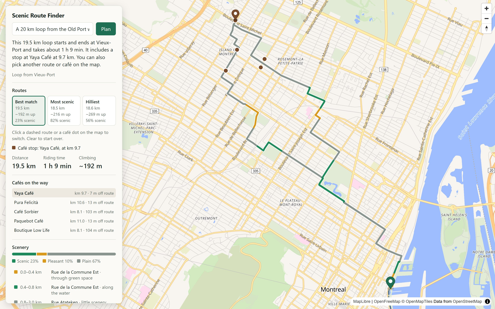
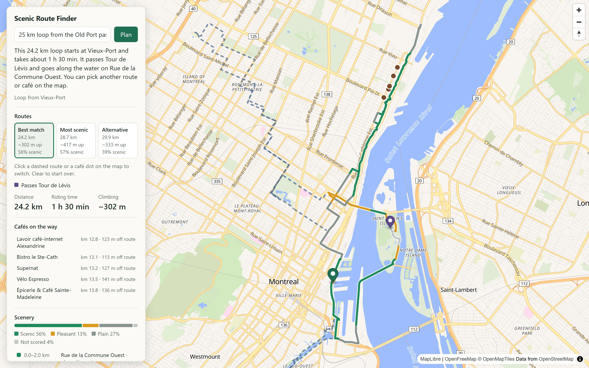
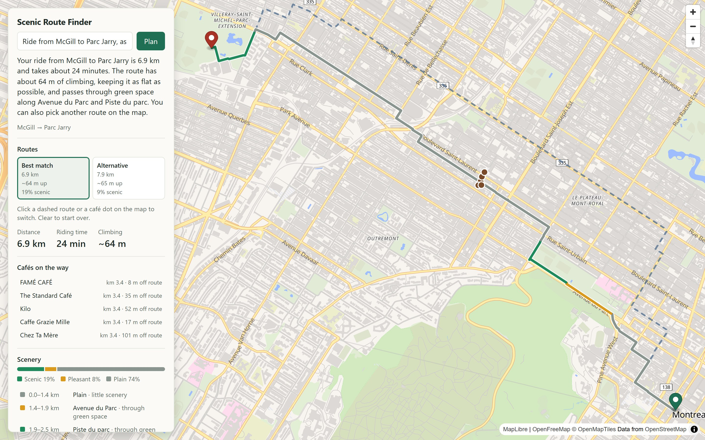

# Scenic Route Finder

Turns a plain-language cycling request into a real, rideable route chosen for scenery and riding feel. The design rule throughout: **the LLM plans; the routing engine routes.**

**Status: Phase 3 of 5 complete, ready for review.** Type a request such as "a 30 km loop from the Old Port" and get a real cycling route. Routes now lean toward scenic areas (water, green space, quiet roads) using scores from an offline pipeline, show their scenery stretch by stretch, can stop at a café, and can seek or avoid climbs. Each plan offers up to three labelled routes and a choice of cafés, switchable without another LLM call. Riders can ask to pass a kind of place ("past a lookout"), found by hybrid search over an embedded index of about 3,400 places (73.9% of labelled queries get the right place first, 100% within the top 5). In a constraint eval of 34 fixed requests, 97.1% of planned routes met everything asked for.



*"A 20 km loop from the Old Port with a coffee stop": three labelled routes, the selected one coloured by scenery (green scenic, amber pleasant, grey plain), the café stop in brown, and the cafés near the middle of the route to switch to.*

| Passing a kind of place | Point to point, as flat as possible |
| --- | --- |
|  |  |
| *"25 km loop from the Old Port past a lookout with a view": `search_places` found Tour de Lévis, marked in purple.* | *"Ride from McGill to Parc Jarry, as flat as possible": the best match and a dashed alternative.* |

## Architecture

```
Browser (Next.js + MapLibre GL)
   │  POST /api/plan   (/api/route for two map clicks, /api/route/via to switch cafés)
   ▼
FastAPI backend
   │
   ├─▶ Agent loop ──▶ Gemini (parses the request, calls tools, writes the reply)
   │      │
   │      ├─▶ search_places tool ──▶ Gemini embedding of the query
   │      │                          + hybrid search over places (pgvector + name match)
   │      │
   │      └─▶ plan_route tool (RouteSpec)
   │             ├─▶ Nominatim   (place name → coordinates)
   │             ├─▶ GraphHopper (coordinates → real routes, with elevation)
   │             └─▶ PostGIS     (scenery along each route, cafés nearby)
   │
   └─▶ Postgres + PostGIS + pgvector
          ▲  scored road segments, places with description embeddings
          │
   Offline pipeline (python -m pipeline.run)
      OSM extract → segments → scores → scenic zones (for GraphHopper)
                  → places → descriptions → embeddings
```

The LLM only ever sees place names, short place descriptions and route summaries. Coordinates and geometry stay in code, and every route returned to the browser comes straight from the routing engine.

| Path | Purpose |
| --- | --- |
| [backend/app/agent/orchestrator.py](backend/app/agent/orchestrator.py) | The hand-written agent loop, with LLM and tool call logging |
| [backend/app/agent/llm.py](backend/app/agent/llm.py), [gemini.py](backend/app/agent/gemini.py) | Provider-agnostic LLM interface and its Gemini implementation |
| [backend/app/agent/prompts/planner.md](backend/app/agent/prompts/planner.md) | The system prompt |
| [backend/app/tools/plan_route.py](backend/app/tools/plan_route.py) | Turns a `RouteSpec` into up to three route options |
| [backend/app/tools/search_places.py](backend/app/tools/search_places.py) | Finds real places matching a kind of place ("a lookout") |
| [backend/app/retrieval/](backend/app/retrieval/) | Embedding client and hybrid place search |
| [backend/app/scoring/](backend/app/scoring/) | Scenery along a route, and choosing distinct route options |
| [backend/pipeline/](backend/pipeline/) | Offline OSM pipeline: segment scores, scenic zones, places and embeddings |
| [backend/app/models/spec.py](backend/app/models/spec.py) | `RouteSpec`, the structured form of a ride request |
| [backend/app/routing/](backend/app/routing/) | GraphHopper and geocoder clients |
| [backend/app/evaluation/intent_scoring.py](backend/app/evaluation/intent_scoring.py) | Eval scoring, unit tested without an LLM |
| [evals/](evals/) | Labelled requests, eval runner, one results file per version |
| [graphhopper/](graphhopper/) | Pinned GraphHopper image, config, and extract download |
| [postgres/](postgres/) | PostGIS image with pgvector added |
| [frontend/components/RouteMap.tsx](frontend/components/RouteMap.tsx) | Map, ride request box, route display |

## Getting started

Everything runs on your own machine in Docker: the app, the database and the routing engine. Nothing needs to be hosted. These steps were tested on a fresh clone and take about 20 minutes the first time, mostly waiting.

### What you need

- **[Docker Desktop](https://www.docker.com/products/docker-desktop/)** (or Docker Engine with Compose). Python, Node and Java all run inside containers, so you don't need them installed.
- **At least 4 GB of memory for Docker** (6 GB is comfortable). The stack uses about 2.5 GB, and the routing engine can grow to 2 GB while it builds. On Windows and macOS, check this under Docker Desktop's resource settings.
- **About 4 GB of disk** for images and data.
- **A free Gemini API key** from [Google AI Studio](https://aistudio.google.com/apikey), for the AI planner. Without one, the map still works: click two points to get a route.

### 1. Configure

```sh
git clone https://github.com/Spiceyyy/Bike-Buddy.git
cd Bike-Buddy
cp .env.example .env
```

Open `.env` and set `POSTGRES_PASSWORD` (any value) and `GEMINI_API_KEY`. The other settings default to Montreal.

### 2. Start the app

```sh
docker compose up --build
```

The first start downloads the Montreal map data (about 80 MB) and elevation data, then builds the routing graph. On the test machine this took about 3 minutes; the backend starts once the routing engine is ready. Later starts take seconds.

Open <http://localhost:3000>. Routes work now, but without scenery, cafés or place search, which come from the next step.

### 3. Build the scenery and place index

In a second terminal, while the app is running:

```sh
docker compose exec backend python -m pipeline.run
```

This scores about 278,000 road segments, finds cafés and other places, and embeds place descriptions for search. It took about 2.5 minutes plus embedding time.

The free Gemini tier allows about 1,000 embeddings a day, and the index needs about 1,200. The first run embeds what it can and stores the rest; running the same command the next day finishes the job, without repeating any work. Until then, place search matches names instead of meaning. To skip embeddings entirely, add `--no-embeddings`.

### 4. Route with the scenery

```sh
docker compose restart graphhopper
```

The routing engine rebuilds its graph with the scenic zones from step 3. This took about 11 minutes on the test machine; the map keeps working meanwhile, once the engine is back up. You only need to do this again after re-running the pipeline.

### 5. Try it

Open <http://localhost:3000> and describe a ride, for example:

- "A 20 km loop from the Old Port with a coffee stop"
- "Hilly 25 km loop from Parc La Fontaine for climbing training"
- "Ride from McGill to Parc Jarry, as flat as possible"
- "25 km loop from the Old Port past a lookout with a view"

You can also click two points on the map. If you click one point and then describe a ride with no start, the clicked point becomes the start.

To stop everything, press Ctrl+C in the first terminal or run `docker compose down`. Your data stays in Docker volumes for next time.

### If something goes wrong

| Problem | What to do |
| --- | --- |
| The routing engine stops with an out-of-memory error | Give Docker more memory (see above), or lower `GRAPHHOPPER_JAVA_OPTS` in `.env` for a smaller region |
| "port is already allocated" | Another program uses port 3000, 8000, 8989 or the Postgres port. Stop it, or change `POSTGRES_PORT` in `.env` |
| The planner says it has used its quota | The Gemini free tier is per model and per day. Wait, or choose another model (below) |
| "trouble finding those places" | Place names are looked up with the public Nominatim service, which is rate-limited. Wait a minute and retry |
| Routes have no scenery or café choices | Run step 3, then step 4 |

### Choosing a Gemini model

Set `GEMINI_MODEL` in `.env`. The default is `gemini-3.5-flash-lite`. Free-tier quotas are per model and can be small: `gemini-3.5-flash` allowed only 20 requests per day when tested, and each planned ride uses 2.

### Changing region

The default is the [BBBike Montreal extract](https://download.bbbike.org/osm/bbbike/Montreal/) (longitude -74.09 to -73.27, latitude 45.30 to 45.75). To change it, set `OSM_EXTRACT_URL` to any `.osm.pbf` URL and `MAP_CENTER` to a `lon,lat` inside it, then restart. Each extract gets its own graph cache.

### Changing the GraphHopper config

The routing graph is built once and cached. [entrypoint.sh](graphhopper/entrypoint.sh) rebuilds it whenever [graphhopper/config.yml](graphhopper/config.yml) or the scenic zones change, so after editing the config run:

```sh
docker compose up -d --build graphhopper   # rebuilds the graph, a few minutes
```

To force a rebuild for any other reason, clear the cache:

```sh
docker compose stop graphhopper
docker compose run --rm --no-deps --entrypoint sh graphhopper -c "rm -rf /data/graph-cache/*"
docker compose up -d --build
```

The graph includes SRTM elevation (downloaded once into the data volume) and `average_slope`, used for climbing requests.

### Scenic scoring pipeline

```sh
docker compose exec backend python -m pipeline.run            # score and write to PostGIS
docker compose exec backend python -m pipeline.run --dry-run  # score and print a summary only
```

The pipeline reads the same OSM extract as GraphHopper and writes one row per road segment to the `road_segments` table. Montreal produces about 278,000 segments (21,000 km) in roughly 80 seconds. It also writes scenic zones for GraphHopper (see below), and the 1,250 named cafés in the extract to the `places` table, for café stops. After a run, restart GraphHopper to route with the new zones:

```sh
docker compose restart graphhopper   # rebuilds the routing graph, about 7 minutes
```

How a segment is scored ([backend/pipeline/](backend/pipeline/)):

1. **Segment.** Rideable ways are split at every intersection, and again every 400 m, so one score never averages a riverside path with the arterial road it turns into.
2. **Measure.** Points are sampled every 25 m along each segment. Each feature is a share from 0 to 1, where 1 is better:

   | Feature | Weight | Measured as |
   | --- | --- | --- |
   | Water | 0.30 | Share of the segment within 100 m of a river, canal or lake |
   | Green | 0.25 | Share within 50 m of a park, wood, cemetery or nature reserve |
   | Quietness | 0.25 | Road class as a traffic proxy (cycleway 1.0 to trunk 0.0), capped on roads of 70 km/h or more, raised by separated bike tracks |
   | Calmness | 0.10 | Fewer intersections within 200 m means fewer stops |
   | Viewpoint | 0.05 | A mapped viewpoint within 200 m |
   | Surface | 0.05 | Smoothness from the surface tag. Preferring gravel is a per-ride choice applied later, not part of this score |

3. **Score.** The scenic score is the weighted sum, so every score can be explained feature by feature. Weights are hand-tuned for now, in [scoring.py](backend/pipeline/scoring.py).

Green areas under 0.5 ha and water under 0.2 ha are ignored, because OSM maps planters as gardens and fountains as water. Before this filter, downtown Rue Sainte-Catherine scored 36% green.

Spot checks after a full run:

| Street | Score | Why |
| --- | --- | --- |
| Lachine Canal bike path | 0.89 | Water and green all the way, no traffic |
| Chemin Olmsted (Mount Royal) | 0.60 | Fully green and quiet, no water |
| Rue Rachel Est | 0.33 | Quiet, with a bike path, but little scenery |
| Rue Sainte-Catherine Ouest | 0.21 | Busy, and an intersection every block |
| Rue Sherbrooke Est | 0.14 | Arterial road with little green |

#### How routing uses the scores

GraphHopper cannot read a score per segment without custom Java code, but its custom models can test whether a road lies in a named area. So the pipeline ([scenic_zones.py](backend/pipeline/scenic_zones.py)):

1. Cuts the map into 150 m cells and gives each cell the length-weighted mean score of its segments.
2. Groups cells scoring 0.55 or more into a `scenic` zone, and 0.40 to 0.55 into a `pleasant` zone.
3. Writes a custom model for the `scenic` profile. GraphHopper only lets a custom model lower priority, so roads in pleasant zones get ×0.7 and roads outside both get ×0.5. Routes are drawn toward scenic areas, and the built-in bike model still picks the quietest roads within each zone.

The zones are baked into the routing graph. [entrypoint.sh](graphhopper/entrypoint.sh) installs them at startup and rebuilds the graph whenever they change. Before the pipeline has run, the `scenic` profile routes exactly like `bike`. The app uses `scenic` by default (`GRAPHHOPPER_PROFILE`).

#### Scenery along each route

Every route, planned or clicked, comes back with a stretch-by-stretch scenery breakdown ([stretches.py](backend/app/scoring/stretches.py)). The map colours the route by band, and the panel lists each stretch. Clicking a stretch zooms to it.

1. The route is sampled every 25 m, and each point takes the score of the nearest scored segment within 15 m.
2. Consecutive points in the same band become a stretch, using the zone thresholds: scenic at 0.55 or more, pleasant from 0.40, plain below that. Points with no segment nearby are "not scored".
3. Stretches shorter than 300 m are merged into their longer neighbour, so one bridge does not split a canal ride.
4. Each stretch gets the OSM name covering most of it, and a reason: the feature that contributed most to its score (water, green space or quiet streets), or "busy road" / "little scenery" for plain stretches.

The `plan_route` tool also passes the planner up to three named scenic stretches, so the reply can mention places that are actually on the route. Looking up a 14 km route takes about 100 ms. If the database is down or the pipeline has not run, routes are returned without scenery.

### Café stops and climbing

The planner understands two more things in a request ([spec.py](backend/app/models/spec.py)):

| Field | Set when the rider says | What the planner does |
| --- | --- | --- |
| `stop: cafe` | "a café halfway", "coffee break on the way", "ride to a café" | Finds the café nearest the middle of the route, within 150 m, or else 600 m, and routes through it |
| `climbing: seek` | "hilly", "elevation training", "beaucoup de côtes" | Lowers the priority of flat roads, then keeps the hilliest candidate loop |
| `climbing: avoid` | "flat", "easy on the knees", or any climbing limit | Lowers the priority of steep climbs, then keeps the flattest candidate loop |

How it works ([plan_route.py](backend/app/tools/plan_route.py)):

- **Loops with a café.** The planner looks for a café between 30% and 70% of a candidate loop. If one is found, it re-routes through the loop's own 25% and 75% points and the café, so the ride keeps its shape rather than turning into an out-and-back. This is done for the four best loops, and the re-routed loops are ranked again, because going through a café changes a loop's length. In one test it would otherwise have shrunk a 40 km request to 32 km. If no loop passes a café, the reply says so.
- **Point-to-point with a café.** It looks along the middle half of the direct route, then routes start → café → end.
- **Climbing.** GraphHopper custom models can only lower priorities, so "seek" makes flat roads (slope under 2%) less attractive rather than hills more attractive ([climbing.py](backend/app/routing/climbing.py)). Across two 25 km loop starts, this plus picking the hilliest seed gave 407 and 697 m of climbing, against medians of 257 and 373 m without it.
- **Climbing limits.** A limit also sets `climbing: avoid`, enforced in `RouteSpec` rather than left to the prompt. Because the avoid model only reshuffles elevation noise on flat ground, a limit makes the planner try 8 plain loops as well as 8 avoiding climbs; the loop with the least climbing near the requested distance wins, so a candidate under the limit is never lost. The reply says when none met it.

The panel shows the café as a brown marker, its distance into the ride, and the route's climbing.

### Choosing a route and a café

The LLM runs once, to turn the request into a `RouteSpec`. Every choice after that goes straight to the backend, so switching is instant, costs no LLM quota, and cannot be misread.

```
"25 km loop with a coffee stop"
   │  /api/plan: LLM parses once
   ▼
candidates: 8 loops, or up to 3 GraphHopper alternatives
   │  re-routed through a café if asked, ranked, scored for scenery
   ▼
up to 3 distinct options, each with 5 cafés near its middle
   │  rider clicks an option card, a dashed route, or a café dot
   ▼
/api/route/via (no LLM) ──▶ GraphHopper ──▶ new route
```

- **Options** ([candidates.py](backend/app/scoring/candidates.py)). The best-ranked route comes first as "Best match". Others are added for what they are best at: "Most scenic" (largest scenic share), "Hilliest" and "Flattest" (a rider seeking climbs is not offered the flattest, and the reverse). A label is only used when its route beats the best match on that measure. Two routes are treated as the same if more than 70% of either lies within about 40 to 80 m of the other, so the options are real alternatives. Loops more than 20% off the requested distance are never offered.
- **Café choices.** Each option lists up to five cafés within 600 m of the middle of the route, those within 150 m first. Every option, including ones with no stop requested, gets the list, so a café can be added to any planned ride.
- **Keeping the route's shape.** Each option carries anchor points along its shape (6 for a loop, 3 for a point-to-point ride). Re-routing through a café passes those anchors and inserts the café where it adds the least detour. Before this, two anchors were used, and a café at 31% of a 24.7 km loop cut it to 15.9 km; with six, re-routing a loop through each of its five café choices stayed within 8% of the original length in 15 of 15 tries.
- **Stateless.** The plan response includes the resolved start and end and each option's anchors, so `/api/route/via` needs no session or stored state.


Ferries are excluded because a route must be rideable end to end, and motorways are left out of the graph. Points outside the extract's bounding box return a 422.

### Finding places: `search_places`

Riders often describe a kind of place rather than name one: "a 25 km loop from the Old Port past a lookout". `search_places` turns that into real places the route can pass, without the LLM ever inventing one.

```
"25 km loop from the Old Port past a lookout"
   │  LLM calls search_places(query="lookout with a view", near_place="Old Port", within_km=8)
   ▼
hybrid search over the place index ──▶ Belvédère Kondiaronk 2.4 km, Belvédère Camillien-Houde ...
   │  LLM calls plan_route(..., via_places=["Belvédère Kondiaronk"])
   ▼
8 loops of the requested length, each re-routed through the lookout, ranked as usual
```

**The place index** ([places.py](backend/pipeline/places.py)). The pipeline keeps about 3,400 named places from the OSM extract: parks (0.5 ha or more), cafés, lakes and canals (1 ha or more), viewpoints, beaches, and landmarks such as museums, forts and lighthouses. Places named only by what they are ("Belvédère", which means lookout) are dropped: a rider cannot be told the route "passes Belvédère", and their bare descriptions matched generic queries so closely that they outranked named lookouts. Each gets a one-sentence description that says what it is and what is around it, computed from the same extract:

> Belvédère Kondiaronk. Viewpoint, a lookout with a view in Ville-Marie, near Colline de l'Abri, in Parc du Mont-Royal.

The context is the nearest neighbourhood name within 2 km, a named hill within 1 km, water within 100 m, and the largest named park the place is inside.

**Embeddings** ([embeddings.py](backend/app/retrieval/embeddings.py)). Descriptions are embedded with `gemini-embedding-2` (768 dimensions, the "document" task type) and stored in Postgres with pgvector. Queries use the "query" task type. Cafés and parks under 2 ha are stored but not embedded: cafés are found by category for stops, and small parks are rarely somewhere a rider sets out for. That leaves 1,182 embedded places. Every embedding, for places and for queries, is cached in an `embedding_cache` table by model and text, so nothing is sent to the API twice.

**Hybrid search** ([place_search.py](backend/app/retrieval/place_search.py)). One SQL query filters places to a radius around the start and ranks them by

```
score = 0.85 × cosine similarity of the embeddings + 0.15 × trigram similarity of the names
```

Embeddings match meaning across words and languages ("lookout" and "belvédère"); name similarity helps exact names such as "Olympic Stadium" and short queries such as "plage". The weighting comes from the retrieval eval below. If the query cannot be embedded, the app falls back to names alone.

**Routing through the places.** `RouteSpec.via_places` takes up to three names. Names that `search_places` returned are resolved from a per-request registry, so they need no geocoding and the LLM never sees their coordinates; names the rider typed ("over the Jacques-Cartier Bridge") are geocoded. For a loop, the planner generates its usual loops of the requested length and inserts each place where it adds the least detour, then ranks the results. Before this, a loop was routed start → place → start, and "30 km loop from the Old Port over the Jacques-Cartier Bridge" came back as 9.1 km; now it is 29.8 km, with three options that all pass the bridge's mapped point. The places are kept as anchors, so picking a café afterwards still passes them. The map marks them in purple.

**Free-tier limits.** The Gemini free tier allows about 100 embeddings a minute and about 1,000 a day, shared by indexing and searching. Indexing the 1,182 places therefore needed pipeline runs on two days; each run continues from the cache. Searches then cost one embedding per new query, and none for repeated ones.

## Known limitations

- **Surface and vibes** are parsed but not applied yet. The app says so on each result.
- **Climbing figures are approximate.** SRTM elevation partly measures buildings and trees, so city routes show extra climbing: the flat Lachine Canal path reads 113 m over 14 km. Comparisons between routes are still meaningful.
- **Climbing limits on point-to-point rides** choose among at most three GraphHopper alternatives, so a limit may be reported as missed.
- **The reply describes the best match.** Switching to another option or café updates the map and panel, but not the written reply.
- **Café distances in the list** ("km 7.7") are measured along the route the list was made for. After switching to another café, the route changes slightly, so they are approximate.
- **Loop distance** is approximate. The planner tries 8 loops and keeps the closest, which landed within 10% for 22 of 24 tested start and distance pairs. When it misses, the reply says so.
- **Embedding quota.** On the free tier, once the day's ~1,000 embeddings are used, new search queries fall back to name matching until the quota resets. Cached queries keep working.
- **Neighbourhood names in place descriptions** come from the nearest OSM neighbourhood point, which is sometimes wrong (Parc Jean-Drapeau is described as being in "Village gai").
- **Place matching** uses the first result from public Nominatim, so a name can match the wrong place. The app always shows the place it actually matched. Nominatim's public service is limited to one request per second and is not suitable for production traffic.

## API

### `POST /api/plan`

```json
{ "message": "A 30 km loop from the Old Port", "map_start": null }
```

`map_start` is an optional `{ "lat", "lon" }`, used when the message names no start.

Returns `reply`, `route` (a GeoJSON Feature, or null), `spec` (the parsed `RouteSpec`), `start_name` and `end_name` (the places actually matched), `stop` (the café routed through, with its coordinate and `distance_along_m`, or null), `options` (up to three, each with `label`, `route`, `stop`, `stop_choices` and `anchors`; the first matches `route` and `stop`), `start` and `end` (resolved coordinates; `end` is null for loops), `via` (the places the route passes, with coordinates), `not_applied`, and `usage` (LLM calls, tokens, latency).

| Status | Meaning |
| --- | --- |
| 422 | Invalid input |
| 429 | The LLM provider's rate limit or quota was reached |
| 502 | The LLM provider failed |
| 503 | `GEMINI_API_KEY` is not set |

### `POST /api/route/via`

Re-routes a planned option through a stop the rider picked. No LLM is involved.

```json
{
  "start": { "lat": 45.526, "lon": -73.569 },
  "end": null,
  "anchors": [{ "lat": 45.51, "lon": -73.58 }, "..."],
  "stop": { "name": "Café Central", "coordinate": { "lat": 45.47, "lon": -73.58 } },
  "category": "cafe",
  "climbing": "any"
}
```

`start`, `end` and `anchors` come from the plan response (`end` is null for a loop, at most 8 anchors). Returns `route` (with scenery) and `stop` (with `distance_along_m`). Errors are the same as `/api/route`.

### `POST /api/route`

```json
{ "start": { "lat": 45.504, "lon": -73.553 }, "end": { "lat": 45.435, "lon": -73.675 } }
```

Returns a GeoJSON Feature (coordinates shortened):

```json
{
  "type": "Feature",
  "geometry": { "type": "LineString", "coordinates": [[-73.552942, 45.503985], "..."] },
  "properties": { "distance_m": 14085.476, "duration_s": 2914.339, "profile": "bike", "ascend_m": 113.2, "descend_m": 120.5, "scenic": { "...": "..." } }
}
```

| Status | Meaning |
| --- | --- |
| 422 | Invalid input, or a point is outside the region or too far from a road |
| 404 | Both points are valid, but no cycling connection exists |

`properties.scenic` holds `score`, `matched_share`, `band_shares` and `stretches` (each with `start_m`, `end_m`, `band`, `score`, `reason`, `name` and `coordinates`), or null when scenery is unavailable. Routes from `/api/plan` carry the same field.
| 502 | The routing engine is unavailable or returned something unexpected |

### `GET /health`

Reports `graphhopper` and `postgis` as booleans. Returns 503 if either is down.

## Tests

```sh
docker compose run --rm --no-deps backend pytest
```

The LLM, geocoder and routing engine are all faked, so the tests need no running services and no API key.

## Evaluation

```sh
docker compose exec backend python /evals/run_evals.py --version my-version
```

The eval sends 40 hand-labelled requests from [evals/requests.jsonl](evals/requests.jsonl) to the live LLM and scores its first response. They cover loops, point-to-point rides, café stops, climbing goals, places to pass, French requests, missing details, and messages that are not ride requests. The model is offered the same two tools as in the app, `plan_route` and `search_places`. For a request naming a kind of place ("past a lookout"), the right first move is `search_places`; searching when it was not needed counts as a wrong decision. Results are saved after every request, so a run stopped by a quota continues when the same command is re-run.

Current result, `gemini-3.5-flash-lite` ([v7](evals/results/v7-gemini-3.5-flash-lite.json)), on all 40 requests:

| Metric | Result |
| --- | --- |
| Exact match (every field correct, or the right search) | 95.0% (38 of 40) |
| Correct first move (plan, search, or neither) | 95.0% (38 of 40) |
| Median latency per response | 1,002 ms |
| Tokens across all 40 | 83,759 in, 1,637 out |

All four new requests passed: three searched first (for "lookout with a view", "plage" and "lighthouse"), and "40 km loop from Lachine that goes over the Jacques-Cartier Bridge" put the bridge straight into `via_places`. The two misses:

- "A quiet 50 km loop along the water with a café halfway" searched for "water" instead of treating it as a vibe. With `search_places` available, the model reads "along the water" as a place to pass. The prompt says otherwise, but this is a fair ambiguity.
- "Plan me a ride" got a request for details instead of a tool call, as in v3 to v5.

Offering a second tool roughly doubled the input tokens per request (the tool schema is sent each time).

[v6](evals/results/v6-gemini-3.5-flash-lite.json), with only `plan_route` offered and 36 requests, scored 97.2% (35 of 36).

The one miss is "I want to go to a cafe and have a good elevation training, 40 km from Outremont", which the model keeps reading as a ride to somewhere:

- In [v5](evals/results/v5-gemini-3.5-flash-lite.json) it set the destination to "a cafe". A prompt rule did not fix this, so `RouteSpec` now rejects generic names such as "a cafe" as a place, with a message saying to set `stop` instead. In the app, the orchestrator returns that message to the model, which corrects itself on the next call (3 LLM calls instead of 2).
- In v6 it planned a point-to-point ride from Outremont to Outremont. The prompt already says such a ride is a loop, so `RouteSpec` now enforces that rule. The stored v6 result predates it.

The eval scores only the first call, so neither correction shows in its numbers. (In v7 this request passed.)

[v4](evals/results/v4-gemini-3.5-flash-lite.json) and v5 both scored 94.4%. Between v3 and v4, the `cafe` vibe became the `stop` field, and a climbing limit now also sets `climbing: avoid`: the model did this unprompted, and avoiding climbs makes a route more likely to stay under the limit, so two labels were updated to match.

Earlier prompt versions ([v1](evals/results/v1-gemini-3.5-flash-lite.json), [v2](evals/results/v2-gemini-3.5-flash-lite.json)) scored 100% on 30 requests. Treat these numbers with care: there are only 40 requests, one person wrote both the labels and the prompt, and small wording changes moved the score. A held-out set would give a more reliable figure.

### Retrieval: does `search_places` find the right places?

```sh
docker compose exec backend python /evals/run_retrieval.py --version my-version
```

[evals/retrieval_queries.jsonl](evals/retrieval_queries.jsonl) holds 23 queries, each with a start point, a radius and the places that count as a right answer (every OSM variant of a name, such as "Canal de Lachine", "Canal-de-Lachine" and "Canal Lachine"). They mix vague requests ("lookout with a view of the city", "park on a former quarry"), named places ("Lachine Canal", "Olympic Stadium") and French ("plage", "parc avec un lac"). Each query runs through three modes, hybrid (what the app uses), embeddings only, and names only, scored by recall@1, recall@5 and mean reciprocal rank. No LLM is involved; query embeddings are cached, so re-runs cost no API calls.

Current result ([v3](evals/results/retrieval-v3.json)), 23 queries, top 5:

| Mode | recall@1 | recall@5 | MRR |
| --- | --- | --- | --- |
| **Hybrid (0.85 / 0.15, in use)** | **73.9%** | **100%** | **0.824** |
| Embeddings only | 69.6% | 100% | 0.800 |
| Names only | 43.5% | 56.5% | 0.493 |

Embeddings do most of the work: names alone find the right place in the top 5 for only about half the queries, because vague requests ("lookout with a view of the city", "park on a former quarry") share no words with the places' names. The hybrid adds a little on top, on short or named queries: "plage" puts Plage urbaine de Verdun first instead of second.

How the numbers got here, step by step:

- **The first run was discarded.** It was made after indexing had used most of the day's embedding quota, so most queries could not be embedded and quietly fell back to name matching. The eval now stops with an error instead of falling back, and query embeddings are cached so re-runs cost nothing.
- **One label was corrected after seeing results.** For "parc avec un lac", hybrid search returned Parc Lacoursière, the park around Lac Lacoursière; the label had listed the lake but not the park. Adding it moved hybrid recall@5 from 91.3% to 95.7% ([v1](evals/results/retrieval-v1.json)).
- **The weighting was chosen with a sweep** over the same 23 queries (`--sweep 1.0 0.95 0.9 0.85 0.8 0.75 0.65 0.5`). Semantic weights from 0.80 to 0.90 tied for best (recall@5 100%, MRR about 0.80); 0.75, the first guess, dropped one query out of the top 5; 0.65 and below got steadily worse, as names starting with "Parc" or "Plage" crowded out better matches. 0.85 is the middle of the tied range ([v2](evals/results/retrieval-v2.json)).
- **Generic names were removed** (see above), which moved hybrid recall@1 from 69.6% to 73.9% (v3).

The remaining miss at rank 1 that the data explains best: "archaeology and history museum" finds Pointe-à-Callière only fifth, because its description says no more than "Museum in Vieux-Montréal, by the water". OSM tags say little about what a museum is about; Wikipedia summaries, listed in the project plan as a data source, would fix that.

Treat these numbers with care: 23 queries, labelled by the same person who built the search, and the weighting and one label were set on the same queries. A held-out set would be more reliable.

### Constraints: do planned routes meet the request?

```sh
docker compose exec backend python /evals/run_constraints.py --version my-version
```

The intent and retrieval evals check that the request is understood and the right places are found. This one checks the routes themselves. [evals/constraint_cases.json](evals/constraint_cases.json) holds 34 fixed `RouteSpec`s: plain loops from six starts at 15 and 30 km, climbing limits, "seek" and "avoid" climbing goals, café stops on loops and point-to-point rides, and places to pass. Each is planned with the real routing engine, scenery scores and café index, exactly as after the LLM has parsed a request, and the best option is checked ([constraints.py](backend/app/evaluation/constraints.py)):

| Constraint | Checked as |
| --- | --- |
| Distance | Loops within 10% of the requested distance |
| Climbing limit | Climbing at or under `max_climb_m` |
| Climbing goal | "seek" climbs at least as much as the same ride with no goal, "avoid" no more |
| Café stop | A café was found and routed through |
| Places to pass | Each lies within 75 m of the route, plus the area's radius for large places |

No LLM and no geocoder are involved: place names resolve to fixed coordinates in the cases file, so runs are repeatable.

Current result ([v3](evals/results/constraints-v3.json)):

| Constraint | Requests | Met |
| --- | --- | --- |
| Distance | 30 | 100% |
| Climbing limit | 4 | 75% (3 of 4) |
| Climbing goal | 10 | 100% |
| Café stop | 7 | 100% |
| Places to pass | 5 | 100% |
| **Everything asked for** | **34** | **97.1% (33 of 34)** |

Median planning time is 3.0 s per request (up to 7.4 s), most of it 8 to 16 loop candidates and their scenery.

The one miss: a 25 km loop from Verdun under 150 m of climbing. Verdun is flat, but SRTM reads about 205 m for every candidate, and none of the 16 gets under the limit. The reply says the limit could not be met.

What the earlier runs found:

- **[v1](evals/results/constraints-v1.json), 94.1%.** Two misses. Verdun's climbing limit, as above. And "15 km loop from Rosemont past the Botanical Garden": the garden is located by a point inside its 79 ha, and the nearest rideable road is over 200 m away, so even a route straight there and back failed the 75 m check. The check now adds the area's approximate radius (about 500 m for the garden) for large places, so reaching the edge counts.
- **[v2](evals/results/constraints-v2.json), 91.2%.** The prompt says a climbing limit implies avoiding climbs, so `RouteSpec` started enforcing it. On hilly ground that helped (175 m instead of 232 m around Côte-des-Neiges), but on flat ground the avoid model made routes slightly hillier and lost Ahuntsic's only loop under 150 m. Trying plain loops alongside the avoiding ones (v3) fixed that.

Like the other evals, this is a small, hand-written set, and the checks were adjusted once after seeing results (the area radius). The cases themselves were not changed.

### Route quality: scenic profile against the plain bike profile

```sh
docker compose exec backend python /evals/run_route_quality.py --version my-version
```

Routes 20 fixed trips (10 point-to-point across Montreal, 10 loops) with both profiles and scores each route by sampling it every 25 m and matching each point to the nearest scored segment. Over 99% of route points match a segment. No LLM is involved.

The zone penalty was chosen by a sweep across three strengths:

| Penalty (pleasant / other) | Point-to-point routes improved | Worst point-to-point detour | Median loop score gain |
| --- | --- | --- | --- |
| 0.85 / 0.70 ([v1](evals/results/route-quality-v1.json)) | 3 of 10 | +3.9% | +0.040 |
| **0.70 / 0.50 ([v2](evals/results/route-quality-v2.json), in use)** | 5 of 10 | +8.9% | +0.054 |
| 0.55 / 0.30 (sweep only) | 8 of 10 | +68% | +0.075 |

Current result (v2):

| Metric | Point-to-point | Loops |
| --- | --- | --- |
| Median scenic score, bike → scenic | 0.400 → 0.407 | 0.476 → 0.552 |
| Routes more scenic / less scenic | 5 / 0 | 10 / 0 |
| Median extra distance | +0.3% | +4.6% |
| Largest extra distance | +8.9% | +9.4% |

The scenic profile helps loops most, because a loop has freedom to choose where it goes. Point-to-point trips gain little, because the bike model already prefers bike paths and a stronger push causes long detours. Twenty trips is a small sample, and the same scores are used both to steer and to judge the routes, so this measures whether the steering works, not whether riders find the routes nicer.

## Roadmap

1. **Routing skeleton** (done)
2. **LLM planner** (done): intent parsing into `RouteSpec`, `plan_route` tool, first evals
3. Scenic layer and RAG: scoring pipeline, vector index, `search_places`, multiple candidates and re-ranking, retrieval and constraint evals (done)
4. Polish and proof: faithful explanations, weather, GPX export, feedback, deployment
5. Trainer mode

Map data © [OpenStreetMap](https://www.openstreetmap.org/copyright) contributors. Geocoding by [Nominatim](https://nominatim.org/). Basemap by [OpenFreeMap](https://openfreemap.org/).
